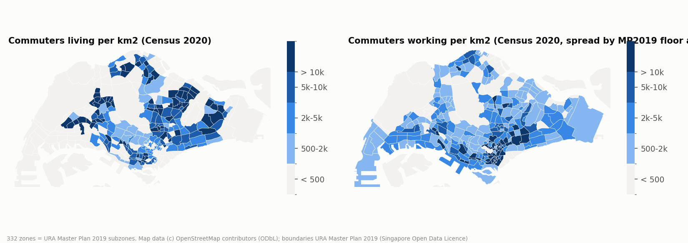
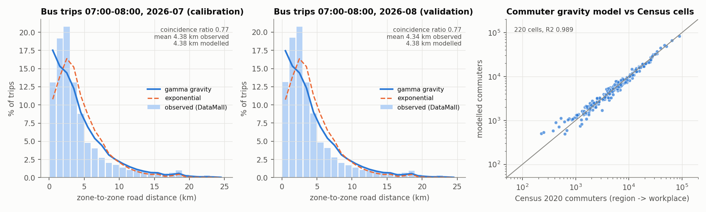
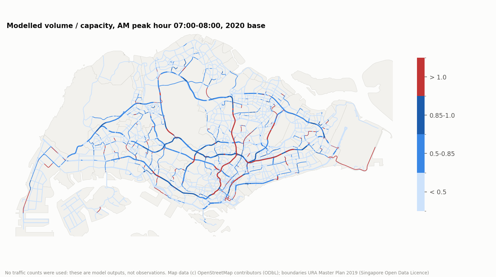
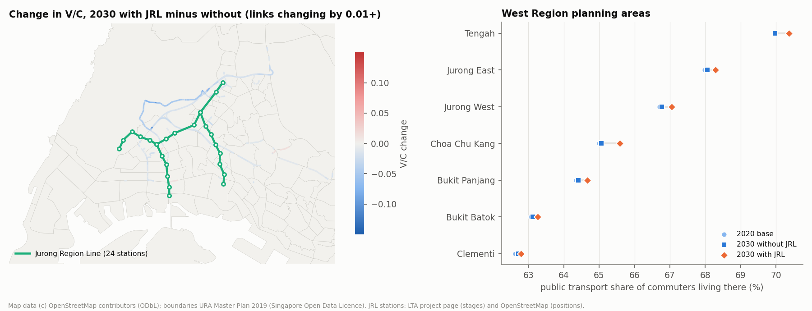

# sg-strategic-transport-model

**A reproducible strategic (four-step) transport model of Singapore for the weekday AM peak hour: 332 URA Master Plan 2019 subzones, commuting from the Census of Population 2020, gravity distribution calibrated to Census and to LTA DataMall bus origin-destination data, logit mode choice, user-equilibrium assignment on the OpenStreetMap road network, and a 2030 test of Tengah with and without the Jurong Region Line.**

> **Read this first.** This is a personal desk study. It is **not an LTA or URA model**, not a consultancy study, and it has not been reviewed by either agency. It uses public data plus stated assumptions, and every input is labelled REAL, DERIVED, ASSUMPTION or ILLUSTRATIVE in the [data provenance](#data-provenance) section. **There are no public link-level traffic counts for Singapore's roads, so the road side of this model is not calibrated or validated against counts; only plausibility checks are reported.** The demand model covers resident commuters with a fixed workplace (Census 2020); all other road traffic enters through one assumed factor.

<!-- README.md is generated from docs/README.template.md by scripts/run_all.py. Do not edit README.md by hand. -->

## What it does

| Step | What | Calibrated or checked against |
|---|---|---|
| a. Zones | 332 MP2019 subzones in 55 planning areas; one centroid each, placed by floor area | - |
| b. Trip generation | 1,831,365 daily commuters (employed residents travelling to a fixed workplace in a named planning area) produced from Census 2020 tables and attracted in proportion to MP2019 floor space; AM peak-hour share from DataMall bus volumes | Census totals by construction |
| c. Distribution | doubly constrained gravity model, gamma deterrence on road distance | commuters: Census 2020 region of residence x planning area of workplace (220 cells); a separate bus-trip model: DataMall bus trip-length distribution, July 2026 (calibration) and August 2026 (validation) |
| d. Mode choice | multinomial logit, car / public transport / other | Census 2020 usual mode of transport to work, by planning area of residence and of workplace; region x workplace cells held out |
| e. Assignment | static user equilibrium, bi-conjugate Frank-Wolfe, BPR links, relative gap <= 1e-06, on 23,800 OpenStreetMap links (motorway to tertiary) | code verified on the Sioux Falls test network against its published equilibrium |
| f. Validation | bus OD: GEH, R2, trip-length distribution; road: V/C distribution and screenlines | no road counts exist: plausibility only |
| g. 2030 scenarios | Tengah built out (42,000 homes, HDB), with and without the 24-station Jurong Region Line; junction growth factors and a worked signal check | - |
| h. Microsimulation | **not done** (optional step; no time left after a-g) | - |

## Headline numbers

All values are generated from the files in [`results/`](results/) by `scripts/run_all.py`.

| | | Source file |
|---|---|---|
| Commuter gravity model vs Census cells | R2 0.989 on 220 region x workplace cells; mean trip length 15.08 km modelled vs 15.08 km Census at that resolution | `results/summary.json`, `calibration_commute_cells.csv` |
| Bus gravity model, calibration month (July 2026, 07:00-08:00) | mean zone-to-zone distance 4.38 km modelled = 4.38 km observed (fitted); coincidence ratio 0.771 | `results/summary.json`, `tld_bus.csv` |
| Bus gravity model, validation month (August 2026) | planning-area pairs: R2 0.971, GEH < 5 for 76% of 2,601 pairs (30% of the 340 pairs with 100+ trips); subzone pairs: R2 0.638 | `results/summary.json`, `bus_pa_pairs_202608.csv` |
| Bus deterrence used for commuting instead | mean commute length 9.3 km instead of 14.3 km (34% shorter); R2 on Census cells 0.814 instead of 0.989 | `results/summary.json` |
| Mode shares, 2020 | car 26.8% / PT 64.3% / other 8.9% modelled; Census 26.8% / 64.0% / 9.2% | `results/summary.json` |
| Mode choice on held-out cells | 206 region x workplace cells: R2 0.61 (car share), 0.79 (PT share); weighted mean absolute error 3.0 and 3.6 points | `results/mode_shares_holdout_cells.csv` |
| Assignment, 2020 AM peak hour | 162,844 car trips/h; relative gap 8.3e-07 after 371 iterations (recomputed independently: 8.3e-07) | `results/summary.json`, `assignment_convergence.csv` |
| Sioux Falls check | the published equilibrium flows give relative gap below 1e-12 in absolute value and objective 42.31335287 in this code (published optimum 42.31335287); this code at gap 8.6e-07: objective 42.313359, largest link-flow difference 0.01% | `results/sioux_falls_check.json` |
| Road plausibility, 2020 | 5.3% of directed link-km above V/C 0.85, 3.0% above 1.0; flow-weighted mean speed 78 km/h on expressways, 39 km/h on primary roads | `results/vc_by_class_base.csv` |
| Tengah, 2030 | 42,000 homes x 3.1 persons = 130,200 residents, 61,215 commuters; 3,758 extra car trips/h | `results/summary.json` |
| Jurong Region Line, 2030 | West Region residents' PT share +0.30 points (65.7% -> 66.0%), Tengah +0.39 points; -526 car trips/h; links in the West with V/C down by 0.05+: 25, up by 0.05+: 0 | `results/summary.json`, `scenario_mode_share_west.csv` |
| How much that JRL result depends on one parameter | the estimated time coefficient is small (-0.0090 per minute); with fixed values from -0.005 to -0.05 the JRL effect on West residents' PT share ranges from 0.17 to 1.51 points | `results/mode_choice_time_profile.csv` |

What the numbers say:

- **The gravity model reproduces where Census commuters work.** With two calibrated parameters, the doubly constrained model fits the 220 region x workplace cells with R2 0.989, and matches the Census mean trip length at that resolution (15.08 km Census, 15.08 km model).
- **Bus trip lengths are the wrong target for commuting.** DataMall counts bus *rides* (tap-in to tap-out), not whole journeys, and they are short: 16.9% of morning-peak rides start and end in the same subzone, and the mean straight-line ride is 2.6 km. Calibrated to bus rides, the deterrence function makes commutes 34% shorter than Census implies. The bus data are therefore used for their own sub-model and for validation, and the commuter model is calibrated to Census.
- **The JRL changes mode shares by tenths of a point, and that number rests on a weakly identified parameter.** Planning-area shares identify housing type and workplace type far better than travel time; the estimated time coefficient is -0.0090 per minute, and forcing -0.03 costs 5,605 log-likelihood units. Read the JRL result as a range (0.17 to 1.51 points), not a forecast.









More figures: [desire lines](results/figures/desire_lines.png), [bus planning-area pairs](results/figures/bus_pa_pairs.png), [mode shares](results/figures/mode_shares.png), [assignment convergence](results/figures/convergence.png). Full validation: [docs/validation_report.md](docs/validation_report.md).

## Method

### a. Zones and networks

- **Zones.** The 332 subzones of URA's Master Plan 2019 (Subzone Boundary, No Sea). 286 have Census 2020 residents; 305 receive commuters. Each zone has one centroid: the floor-area-weighted mean of its MP2019 parcels, moved to a point inside the zone when the mean falls outside.
- **Roads.** OpenStreetMap ways tagged motorway, trunk, primary, secondary, tertiary and their links, from the BBBike extract for Singapore, clipped to the MP2019 boundary, split at junctions, chains of identical links merged, and reduced to the largest strongly connected component: 17,477 nodes, 23,800 directed links, 2,912 directed km. Lanes come from OSM tags on 93% of links and speed limits on 96%; the rest use class defaults (ASSUMPTION). Each zone is connected to its 3 nearest non-expressway nodes.
- **Rail.** 186 stations in the 2020 network (lines and LRT loops in station-code order; positions from LTA's MRT station exits), 210 with the Jurong Region Line (positions of 21 new JRL stations from OpenStreetMap).

### b. Trip generation

The Census 2020 table of employed residents by planning area of workplace, mode and region of residence gives, for each of the five regions, how many residents travel to a workplace in each named planning area. Those who work from home, have no fixed workplace, work outside Singapore or need no transport are left out: 1,831,365 commuters (84.1% of the 2,177,456 employed residents).

- Productions: each region's total is shared among its planning areas by the Census table of employed residents by planning area of residence (less "no transport required"), then among subzones by Census 2020 residents aged 20-64 (ASSUMPTION: equal employment rates within a planning area).
- Attractions: each workplace planning area's total is shared among its subzones by MP2019 floor area (site area x gross plot ratio) weighted by relative job densities per land-use class (ASSUMPTION; only ratios within a planning area matter).
- AM peak hour: daily trips x attendance factor 0.9 (ASSUMPTION) x peak-hour share 28.0% = 461,928 commuter trips from 07:00 to 08:00. The share is DERIVED from DataMall bus tap-ins (07:00-07:59 is the busiest weekday morning hour; share of the 05:00-10:59 window) and transferred to all modes (ASSUMPTION).

### c. Distribution

Doubly constrained gravity model T_ij = A_i O_i B_j D_j f(c_ij), balanced by Furness iteration, with a gamma deterrence function f(c) = c^a exp(-b c) on road distance along the free-flow shortest path (intrazonal distance: half the distance to the nearest other centroid).

- **Commuters**: (a, b) = (-0.492, 0.0424 per km), maximising the multinomial likelihood of the Census region x workplace counts. Fit: R2 0.989, standardised RMSE 0.132 over 220 cells; modelled mean commute 14.3 km.
- **Bus rides**: a second gravity model whose trip ends are the observed tap-ins and tap-outs of each zone between 07:00-08:00 on weekdays (DataMall, July 2026; 401,547 rides per hour). The gamma parameters (-0.836, 0.242 per km) solve the two maximum-likelihood conditions of a doubly constrained gamma model: modelled mean distance and mean log distance equal to the observed ones. An exponential function calibrated by mean trip length (Hyman's condition) is shown for comparison (b = 0.425 per km).

Why the commuter model is not calibrated to the bus trip-length distribution: the bus data are rides, not journeys. A bus-MRT-bus commute appears as two short bus rides; the mean straight-line ride length is 2.6 km. Used for commuters, the bus-calibrated function gives a 9.3 km mean commute (vs 14.3 km) and R2 0.814 on the Census cells.

### d. Mode choice

Multinomial logit on origin-destination pairs:

```
V_car   = asc_car + b_time * t_car + b_priv * private_i + b_central * central_j + b_ind_car * industrial_j
V_pt    =           b_time * g_pt
V_other = asc_other + b_dist_other * d_ij + b_ind_other * industrial_j
```

t_car is free-flow car time plus 6 minutes at the ends; g_pt is the generalised PT time (walking weighted 2.0, waiting 2.0) by the better of a bus-only path and the best rail path (access by walking or feeder bus, transfers penalised); private_i is the share of residents in condominiums and landed housing (Census 2020); central_j flags URA's Central Area; industrial_j is the share of a zone's job weight on Business 1/2 and port land. Modes follow the Census categories: car = car only + taxi/private-hire car only; PT = any combination of MRT/LRT and public bus; other = chartered bus/van, lorry, motorcycle, others.

Calibrated by maximising the log-likelihood of the Census mode counts by planning area of residence and by planning area of workplace at once (converged: yes):

| asc_car | asc_other | b_time (/min) | b_priv | b_central | b_dist_other (/km) | b_ind_car | b_ind_other |
|---|---|---|---|---|---|---|---|
| -1.849 | -3.576 | -0.0090 | 2.185 | -0.276 | 0.0047 | 0.535 | 1.980 |

Mean absolute error 2.0 share points by residence area and 2.5 by workplace area. On the 206 region x workplace cells with 1,000+ commuters, which the calibration never sees cell by cell: R2 0.61 (car share) and 0.79 (PT share).

The time coefficient is weakly identified by planning-area shares. Its profile, and what each value does to the JRL result:

| b_time (per min) |  | log-likelihood minus maximum | West residents' PT share, 2030 without JRL | with JRL | JRL effect (points) | JRL effect on car trips/h |
|---|---|---|---|---|---|---|
| -0.0050 | fixed | -264 | 65.8% | 65.9% | 0.17 | -288 |
| -0.0090 | estimated | 0 | 65.7% | 66.0% | 0.30 | -526 |
| -0.0200 | fixed | -1,721 | 65.6% | 66.3% | 0.65 | -1,144 |
| -0.0300 | fixed | -5,605 | 65.5% | 66.4% | 0.96 | -1,620 |
| -0.0500 | fixed | -16,716 | 65.0% | 66.5% | 1.51 | -2,277 |

### e. Assignment

Car trips per hour = commuters x attendance x peak-hour share x car probability / car occupancy 1.2 (ASSUMPTION) x background factor 1.6 (ASSUMPTION: the model has no goods vehicles, buses, taxis between fares, non-work trips or non-resident workers; this single factor stands in for all of them and is not calibrated). Intrazonal trips are not assigned.

Link costs follow the BPR function t = t0 (1 + 0.15 (v/c)^4) (Bureau of Public Roads 1964). Capacity = lanes x a per-lane capacity by road class, free-flow speed = speed limit x a class factor (both ASSUMPTION, in `config/model.json`). The equilibrium is solved with the bi-conjugate Frank-Wolfe method of Mitradjieva and Lindberg (2013), with exact line search by bisection, falling back to plain Frank-Wolfe whenever the conjugate direction is not a descent direction. The relative gap (TSTT - SPTT) / SPTT is computed every iteration from a fresh all-or-nothing load; the final gap is recomputed independently.

| Scenario | car trips/h | iterations | relative gap | vehicle-hours | vehicle-km |
|---|---|---|---|---|---|
| 2020 base | 162,844 | 371 | 8.3e-07 | 43,653 | 2,252,453 |
| 2030 without JRL | 166,602 | 374 | 7.4e-07 | 44,957 | 2,301,877 |
| 2030 with JRL | 166,076 | 296 | 9.1e-07 | 44,791 | 2,293,851 |

**Why 1e-06 and not 1e-04.** At the iteration where the 2020 run first reaches a relative gap of 1e-04 (iteration 40 of 371), 3.1% of links still differ from the final flows by more than max(10 pcu/h, 2%), the largest difference is 238 pcu/h, and 23 links differ by 0.05 or more in V/C, which is the size of the scenario effects being measured. All three scenarios are therefore solved to 1e-06 (`results/assignment_tightness.csv`). The path of the iterations depends on the last digits of floating-point arithmetic, so a re-run on another machine stops at slightly different flows, within the gap; iteration counts differ too. The saved flows are stored with the demand they were solved for (`results/car_demand_*.npy`), so the equilibrium can be re-checked exactly on any machine.

**Verification on Sioux Falls** (bstabler/TransportationNetworks, pinned commit; `tests/test_sioux_falls.py`). The published best-known flows have relative gap below 1e-12 in absolute value and Beckmann objective 42.31335287 (x 10^5) in this code, the published optimum being 42.31335287. Run to gap 8.6e-07 (970 iterations), this code reaches objective 42.313359 (relative difference 1.3e-07) with every link flow within 0.01% (1.6 vehicles) of the published one. To gap 1e-4, bi-conjugate FW needs 93 iterations and plain FW 1,049.

AequilibraE 1.7.2 also installs on Windows with Python 3.11 (tried in a separate environment, because it pulls NumPy 2.4 and pandas 3.1), and its bi-conjugate Frank-Wolfe ran on Sioux Falls in a one-off trial (relative gap 2.2e-05 after 500 iterations; its flows were not compared further, and the trial is not part of this repository). The model uses its own implementation so that every formula is hand-checked and mutation-tested inside this repository.

### f. Validation

Summary here; details, tables and the reasoning are in [docs/validation_report.md](docs/validation_report.md).

- **Public transport (bus rides).** Calibrated on July, checked on August: coincidence ratio of the trip-length distributions 0.772; planning-area pairs R2 0.971 (R2 0.803 without the intra-planning-area pairs) and GEH < 5 for 76% of 2,601 pairs; subzone pairs R2 0.638. The doubly constrained model with one distance function reproduces the broad pattern between planning areas, not the detail between subzones.
- **Roads.** There are no public traffic counts, so nothing here is calibrated to counts. Plausibility only: 5.3% of directed link-km is above V/C 0.85 in the 2020 base, concentrated on expressways (see the map); flow-weighted mean speeds are 78 km/h on expressways and 39 km/h on primary roads; assigned flows across two north-south screenlines exceed the OD demand that must cross them, as they should when routes cross a line more than once.

### g. 2030: Tengah and the Jurong Region Line

- **Tengah**: HDB's 42,000 homes (HDB, Tengah annex, 2024) spread over Tengah's MP2019 residential parcels by floor area, 3.1 persons per home (ASSUMPTION) and the West Region's 2020 ratio of commuters to residents (0.470): 61,215 extra commuters; 3,892 jobs on Tengah's own non-residential parcels; other attractions scaled up to balance. Full build-out by 2030 is an upper bound (ASSUMPTION). Everything outside Tengah is held at 2020 levels, so the scenarios isolate Tengah and the JRL.
- **Jurong Region Line**: 24 stations in three stages, 2028 to 2029, per LTA's project page (retrieved 2026-11-15); the in-fill station JS2A (mid-2030s) is left out. Distribution is held fixed between the two 2030 runs; the JRL acts through mode choice only.
- **Result**: average generalised PT time change for West Region commuters -1.5 min (Tengah -2.2 min; 11% of West commuters save 5 minutes or more). Mode share of West residents: car 24.0% -> 23.8%, PT 65.7% -> 66.0%.

| Planning area (West Region) | commuters 2030 | PT 2020 | PT 2030 without JRL | PT 2030 with JRL | change with JRL (points) |
|---|---|---|---|---|---|
| Jurong West | 123,923 | 66.7% | 66.8% | 67.1% | +0.28 |
| Choa Chu Kang | 93,626 | 65.0% | 65.1% | 65.6% | +0.53 |
| Bukit Batok | 76,259 | 63.1% | 63.1% | 63.3% | +0.14 |
| Bukit Panjang | 64,779 | 64.3% | 64.4% | 64.7% | +0.26 |
| Tengah | 61,215 | - | 70.0% | 70.4% | +0.39 |
| Clementi | 40,061 | 62.6% | 62.7% | 62.8% | +0.08 |
| Jurong East | 34,795 | 68.0% | 68.1% | 68.3% | +0.23 |
| Western Water Catchment | 303 | 63.0% | 62.9% | 66.9% | +3.95 |

**Junction growth factors.** Signalised junctions are clusters of OSM traffic-signal nodes within 60 m (expressway carriageways excluded). For the 153 clusters in the West Region with 3+ approaches and 500+ pcu/h, `results/junction_growth_factors.csv` lists each approach's modelled flow in the three scenarios and the growth factors (2030 / 2020); the median junction factor without the JRL is 1.026 (largest 2.22).

**Worked example**: how growth factors feed a junction capacity check, at the junction with the largest growth in entering flow (Bukit Batok Road / Jurong Town Hall Road, near 17,314 E, 36,454 N (SVY21)).

1. Base turning flows are estimated from the modelled approach and exit flows by Furness balancing with U-turns banned. In a real study these would be a surveyed turning count; here they are model outputs standing in for one (ILLUSTRATIVE).
2. Each approach's turning flows are multiplied by its growth factor, then balanced again to the forecast exit flows (`results/junction_example_turns.csv`).
3. Each scenario is checked with the critical flow-ratio method: opposing approaches share a phase, approach lanes are the OSM lane count of the approach link (which may include turning pockets), saturation flow 1,900 pcu/h per approach lane (HCM 2000 base value; ASSUMPTION for Singapore), 4 s lost per phase, Webster's optimum cycle, degree of saturation X per approach and Webster's delay (`stm/junction.py`).

| Approach | 2020 base (pcu/h) | 2030 without JRL | growth factor | 2030 with JRL | growth factor |
|---|---|---|---|---|---|
| Bukit Batok Road | 2,250 | 3,121 | 1.387 | 3,095 | 1.375 |
| Jurong Town Hall Road | 1,113 | 1,117 | 1.004 | 1,118 | 1.004 |
| (unnamed link) | 113 | 122 | 1.078 | 122 | 1.076 |
| (unnamed link) | 134 | 362 | 2.710 | 354 | 2.650 |

|  | Y (sum of critical ratios) | cycle (s) | highest degree of saturation X | approaches over X = 0.9 |
|---|---|---|---|---|
| base 2020 | 0.204 | 60 | 0.236 | 0 |
| dm 2030 | 0.330 | 60 | 0.381 | 0 |
| ds 2030 jrl | 0.326 | 60 | 0.376 | 0 |

## Data provenance

REAL = published or observed data, used as published. DERIVED = computed here from REAL data. ASSUMPTION = chosen by the author, no source. ILLUSTRATIVE = used only in the worked example. **No input is synthetic data presented as observed.** SHA-256 hashes: `data/inputs/raw_sources.csv` (raw downloads) and `data/inputs/manifest.csv` (committed inputs). Licences and attribution: [DATA_SOURCES.md](DATA_SOURCES.md).

| Input | Status | Source | Accessed |
|---|---|---|---|
| Subzone and planning-area boundaries, Master Plan 2019 (No Sea) | REAL | URA via data.gov.sg, datasets `d_8594ae9ff96d0c708bc2af633048edfb`, `d_4765db0e87b9c86336792efe8a1f7a66` | 2026-11-14 |
| Master Plan 2019 land use (parcels, use, gross plot ratio) | REAL | URA via data.gov.sg, `d_90d86daa5bfaa371668b84fa5f01424f` | 2026-11-14 |
| Employed residents by planning area of residence and usual mode of transport to work (Census 2020) | REAL | SingStat via data.gov.sg, `d_1f8f5ec7201964e365c77551cab99503` | 2026-11-15 |
| Employed residents by planning area of workplace, usual mode and region of residence (Census 2020) | REAL | SingStat via data.gov.sg, `d_5b38192e9c6f8d2c5f38c70939c76e71` | 2026-11-15 |
| Resident population by subzone, age group and sex; by subzone and type of dwelling (Census 2020) | REAL | SingStat Table Builder 17560 and 17562, https://tablebuilder.singstat.gov.sg/table/CT/17560 | 2026-11-15 |
| Passenger volume by origin-destination bus stops, July and August 2026; bus stops | REAL (aggregated to zones here; raw files not redistributed) | LTA DataMall (downloaded 2026-09-26 with the owner's own AccountKey) | 2026-09-26 |
| MRT/LRT station exits (station positions) | REAL | LTA via data.gov.sg, `d_b39d3a0871985372d7e1637193335da5` | 2026-11-09 |
| Road network and JRL station positions | REAL | (c) OpenStreetMap contributors, BBBike extract for Singapore (file dated 2026-09-26) | 2026-09-26 |
| Jurong Region Line stages and station codes | REAL | LTA, https://www.lta.gov.sg/content/ltagov/en/upcoming_projects/rail_expansion/jurong_region_line.html | 2026-11-15 |
| Tengah: about 42,000 homes when fully developed | REAL | HDB, Annex B to a 2024 news release, https://www.hdb.gov.sg/-/media/hdb-pulse/news/2024/four-tengah-bto-projects-awarded-top-tier-active-beautiful-clean-waters-certification/Annex-B.pdf | 2026-11-15 |
| Sioux Falls test network and best-known flows | REAL (test data; "for academic research purposes only", downloaded, not committed) | https://github.com/bstabler/TransportationNetworks, commit 977ee75 | 2026-11-15 |
| BPR parameters 0.15 and 4 | REAL (standard) | Bureau of Public Roads (1964), Traffic Assignment Manual | - |
| Peak-hour share, AM peak hour | DERIVED | from the DataMall bus volumes above | - |
| Rail line order | DERIVED | LTA station codes | - |
| Base turning flows in the junction example | ILLUSTRATIVE | modelled flows standing in for a count | - |

Every model parameter, with its status and note, generated from `config/model.json`:

| Parameter (config/model.json) | Value | Status | Note / source |
|---|---|---|---|
| `seed` | 20261115 | ASSUMPTION | recorded for completeness: the model uses no random numbers (the tests use their own fixed seeds) |
| `period.am_peak_hour` | 7 | DERIVED | 07:00-07:59, the weekday morning hour with most bus tap-ins in LTA DataMall origin-destination volumes (July and August 2026) |
| `period.morning_window` | 5, 10 | ASSUMPTION | tap-in hours 05:00-10:59 taken as the outbound morning window when deriving the peak-hour share |
| `period.bus_weekdays` | 202607: 23; 202608: 20 | ASSUMPTION | Monday-Friday days less public holidays: July 2026 has 23 weekdays and no public holiday; August 2026 has 21 weekdays, less Monday 10 August. The Ministry of Manpower's 2026 list (https://www.mom.gov.sg/employment-practices/public-holidays, retrieved 2026-11-15) gives National Day on Sunday 9 August 2026 and says Monday 10 August 2026 is a public holiday if the rest day falls on 9 August. Whether DataMall files 10 August under WEEKDAY or WEEKENDS/HOLIDAY was not verified; 20 is assumed. |
| `generation.attendance_factor` | 0.9 | ASSUMPTION | share of employed residents with a fixed workplace who travel to it on an average weekday (leave, sickness, shifts, hybrid work) |
| `generation.production_weight` | pop_20_64 | ASSUMPTION | employed residents of a planning area are spread over its subzones in proportion to Census 2020 residents aged 20-64 |
| `generation.plot_ratio_defaults` | LND: 1.4; other_codes: 1.0 | ASSUMPTION | MP2019 parcels whose GPR is a code (LND landed housing; EVA, SDP, NA) get these plot ratios when floor area is estimated |
| `generation.job_weight_per_m2_gfa` | COMMERCIAL: 1.0; WHITE: 1.0; BUSINESS PARK: 0.8; BUSINESS PARK - WHITE: 0.8; BUSINESS 1 - WHITE: 0.6; BUSINESS 2 - WHITE: 0.5; COMMERCIAL / INSTITUTION: 0.8; HOTEL: 0.3; BUSINESS 1: 0.5; BUSINESS 2: 0.35; COMMERCIAL & RESIDENTIAL: 0.3; RESIDENTIAL WITH COMMERCIAL AT 1ST STOREY: 0.1; CIVIC & COMMUNITY INSTITUTION: 0.5; EDUCATIONAL INSTITUTION: 0.4; HEALTH & MEDICAL CARE: 0.8; RESIDENTIAL / INSTITUTION: 0.3; PLACE OF WORSHIP: 0.1; PORT / AIRPORT: 0.3; UTILITY: 0.1; TRANSPORT FACILITIES: 0.2; SPECIAL USE: 0.2; RESIDENTIAL: 0.02 | ASSUMPTION | relative jobs per m2 of estimated floor area by MP2019 land-use class; they only share the Census workplace total of a planning area among its subzones, so only ratios within a planning area matter |
| `distribution.cost` | road network distance (km) along the free-flow shortest-time path between zone centroids | ASSUMPTION |  |
| `distribution.intrazonal_factor` | 0.5 | ASSUMPTION | intrazonal distance = factor x distance to the nearest other zone centroid |
| `distribution.deterrence` | gamma: f(c) = c^a * exp(-b c) | ASSUMPTION | functional form; a and b are calibrated |
| `distribution.tld_bin_km` | 1.0 | ASSUMPTION | bin width for trip-length distributions and the coincidence ratio |
| `distribution.furness_tol` | 1e-09 | ASSUMPTION |  |
| `mode_choice.modes` | car, pt, other | ASSUMPTION | car = car only + taxi/private-hire car only; pt = any combination of MRT/LRT and public bus (including with other modes); other = private chartered bus/van, lorry/pickup, motorcycle/scooter, others. 'No transport required' is left out of the trip matrix. |
| `mode_choice.car_terminal_min` | 6.0 | ASSUMPTION | parking and walking at both ends of a car trip |
| `mode_choice.car_speed_factor` | 1.0 | ASSUMPTION | car times in mode choice are free-flow network times (no supply-demand feedback) |
| `mode_choice.central_area` | CA_IND = Y in the MP2019 subzone layer | REAL | URA Central Area flag in the Master Plan 2019 subzone boundary data |
| `pt.walk_speed_kmh` | 4.8 | ASSUMPTION |  |
| `pt.walk_detour` | 1.3 | ASSUMPTION | walking or feeder distance / straight-line distance |
| `pt.max_walk_km` | 1.2 | ASSUMPTION | beyond this a station is reached by feeder bus |
| `pt.max_access_km` | 4.0 | ASSUMPTION | stations further than this from a zone centroid are not connected to it |
| `pt.feeder_speed_kmh` | 15.0 | ASSUMPTION |  |
| `pt.feeder_wait_min` | 5.0 | ASSUMPTION |  |
| `pt.rail_wait_min` | 2.5 | ASSUMPTION | half of a 5-minute peak headway |
| `pt.transfer_walk_min` | 3.0 | ASSUMPTION |  |
| `pt.transfer_penalty_min` | 5.0 | ASSUMPTION |  |
| `pt.bus_speed_kmh` | 16.0 | ASSUMPTION | bus-only alternative: road distance at this speed, including stops |
| `pt.bus_access_walk_min` | 5.0 | ASSUMPTION | each end |
| `pt.bus_wait_min` | 5.0 | ASSUMPTION |  |
| `pt.walk_weight` | 2.0 | ASSUMPTION | weight of walking time relative to in-vehicle time |
| `pt.wait_weight` | 2.0 | ASSUMPTION | weight of waiting time relative to in-vehicle time |
| `assignment.bpr_alpha` | 0.15 | REAL | Bureau of Public Roads (1964), Traffic Assignment Manual, U.S. Department of Commerce |
| `assignment.bpr_beta` | 4.0 | REAL | as above |
| `assignment.rgap_target` | 1e-06 | ASSUMPTION | relative gap = (TSTT - SPTT) / SPTT. Tighter than the usual 1e-4 because scenarios are compared link by link |
| `assignment.rgap_reference` | 0.0001 | ASSUMPTION | looser gap at which the flows are compared with the final ones, to show what stopping there would cost |
| `assignment.max_iter` | 3000 | ASSUMPTION |  |
| `assignment.car_occupancy` | 1.2 | ASSUMPTION | persons per car or taxi on the commute; not verified |
| `assignment.background_factor` | 1.6 | ASSUMPTION | AM peak-hour car traffic / modelled resident commuter car traffic. The model has no goods vehicles, buses, taxis between fares, non-work trips, non-resident workers or workers without a fixed workplace; this single factor stands in for all of them and is not calibrated to anything |
| `assignment.lanes_default` | motorway: 3; motorway_link: 1; trunk: 3; trunk_link: 1; primary: 2; primary_link: 1; secondary: 2; secondary_link: 1; tertiary: 1; tertiary_link: 1 | ASSUMPTION | lanes per direction where OpenStreetMap has no lanes tag |
| `assignment.capacity_per_lane` | motorway: 1900; motorway_link: 1500; trunk: 1400; trunk_link: 1200; primary: 1000; primary_link: 1000; secondary: 850; secondary_link: 850; tertiary: 700; tertiary_link: 700 | ASSUMPTION | pcu/h/lane, hourly link capacity used in the BPR function (signal losses included for at-grade roads) |
| `assignment.speed_default_kmh` | motorway: 90; motorway_link: 50; trunk: 70; trunk_link: 50; primary: 60; primary_link: 50; secondary: 50; secondary_link: 40; tertiary: 50; tertiary_link: 40 | ASSUMPTION | where OpenStreetMap has no maxspeed tag |
| `assignment.free_flow_speed_factor` | motorway: 1.0; motorway_link: 0.9; trunk: 0.85; trunk_link: 0.85; primary: 0.75; primary_link: 0.75; secondary: 0.7; secondary_link: 0.7; tertiary: 0.65; tertiary_link: 0.65 | ASSUMPTION | free-flow speed = factor x speed limit (at-grade roads lose time at signals even when empty) |
| `assignment.connector_speed_kmh` | 20.0 | ASSUMPTION |  |
| `assignment.connector_detour` | 1.3 | ASSUMPTION |  |
| `assignment.connectors_per_zone` | 3 | ASSUMPTION | nearest road nodes on non-motorway links, preferring nodes inside the zone |
| `scenario_2030.tengah_homes` | 42000 | REAL | HDB: Tengah 'is estimated to provide about 42,000 new homes when fully developed' (Annex B to HDB's 2024 news release on four Tengah BTO projects and ABC Waters certification, https://www.hdb.gov.sg/-/media/hdb-pulse/news/2024/four-tengah-bto-projects-awarded-top-tier-active-beautiful-clean-waters-certification/Annex-B.pdf, retrieved 2026-11-15); the same figure appears in HDB's Tengah Town Design Guide |
| `scenario_2030.tengah_buildout_by_2030` | 1.0 | ASSUMPTION | the whole town is taken as completed and occupied by 2030. This is an upper bound: HDB's completion schedule was not checked, and the split of the 42,000 homes between public and private housing was not verified (all are treated as public housing, the zones' 2020 private-housing share being 0) |
| `scenario_2030.persons_per_home` | 3.1 | ASSUMPTION | close to the Census 2020 average resident household size; not taken from a specific table |
| `scenario_2030.other_growth` | none | ASSUMPTION | outside Tengah, 2030 population and jobs are held at 2020 levels so that the scenarios isolate Tengah and the JRL |
| `scenario_2030.tengah_jobs` | Tengah's MP2019 non-residential parcels x job weights x (jobs per weight unit in the West Region) | ASSUMPTION |  |
| `scenario_2030.jrl_stations` | 24 stations (all three stages, JS2A left out) | REAL | LTA Jurong Region Line page; see config/rail.json |
| `junction.saturation_flow_pcu_per_lane` | 1900 | ASSUMPTION | base saturation flow per approach lane; HCM 2000 uses 1,900 pc/h/ln as the base value |
| `junction.lost_time_per_phase_s` | 4.0 | ASSUMPTION |  |
| `junction.cycle_min_s` | 60 | ASSUMPTION |  |
| `junction.cycle_max_s` | 150 | ASSUMPTION |  |
| `junction.practical_x` | 0.9 | ASSUMPTION | degree of saturation treated as the practical limit |
| `junction.min_approach_flow` | 50 | ASSUMPTION | pcu/h; approaches below this are left out of the phase plan |

## Limitations

- **No road counts.** The road results are plausible-looking model outputs, not validated flows. V/C depends directly on the background factor, the per-lane capacities and the car occupancy, all assumptions.
- **Commuters only.** Students, business, shopping and leisure trips, goods vehicles, and the non-resident workforce are outside the demand model (the background factor stands in for their road traffic). Census 2020 counts residents only.
- **2020 demand, 2026 network.** The road network is OpenStreetMap as of September 2026; the rail network is set back to 2020 by leaving out stations that opened later. Census 2020 describes 2020 travel; whether it reflects travel in other years was not examined.
- **Coarse targets.** The commuter matrix is observed only at region x planning-area level; subzone-level flows are the model's.
- **No feedback.** Mode choice uses free-flow car times, and distribution uses distance, so congestion does not feed back into destination or mode choice; the JRL does not change where people work in the model.
- **Weak time coefficient.** See the profile above: the scenario's mode shift is uncertain by a factor of about five.
- **PT skims are generalised times built from assumptions** (speeds, waits, weights, transfer penalty), not timetables.
- **Tengah at full build-out by 2030** is an upper bound; all other land use is frozen at 2020.
- **Bus rides are not journeys.** The bus sub-model and its validation describe rides; they say nothing direct about whole PT journeys.
- **Junction analysis** uses link-level assignment and Furness-estimated turns, not junction modelling software, and assumed phasing and saturation flows.

## How to run

Python 3.11.

```bash
python -m venv .venv
. .venv/bin/activate              # Windows: .venv\Scripts\activate
pip install -r requirements.txt
python scripts/run_all.py         # model, figures, README.md and docs/validation_report.md (offline, a few minutes)
python scripts/fetch_data.py --only sioux_falls   # test network (needs internet), then:
pytest                            # tests (offline)
python mutation/run_mutants.py    # optional: mutation test of the test suite
```

`scripts/run_all.py` rewrites everything under `results/` from the committed inputs in `data/inputs/`; numbers are deterministic. Two files are exceptions: `results/sioux_falls_check.json` is rewritten only when the Sioux Falls files have been downloaded, and `results/mutation_report.json` only by `mutation/run_mutants.py`. To rebuild the inputs from the raw sources: `pip install -r requirements-tools.txt`, `python scripts/fetch_data.py` (keyless downloads), then `python scripts/prepare_inputs.py --datamall-dir <folder>` with the DataMall files downloaded with your own DataMall AccountKey (none is stored here).

## Tests and mutation testing

53 tests. The formula tests compare against numbers worked out by hand in the test file (Furness balancing, deterrence functions, coincidence ratio, GEH, logit shares, BPR time, integral and derivative, relative gap and line search on a two-link network, a Braess-type network, Webster's cycle and delay, Furness turning flows), parameter-recovery tests for the three calibration routines, the Sioux Falls check, and a rebuild of the model from the committed inputs compared with the committed results and this README. In that rebuild the three saved equilibria are not solved again: each is re-checked independently against its saved demand with one all-or-nothing load, and the base year is solved again from scratch to 1e-04 and compared with the saved flows. `STM_FULL=1 pytest` solves all three again.

`mutation/run_mutants.py` copies the repository, plants one deliberate bug at a time in the core logic and runs the suite. **30 of 30 mutants killed** (30 of 30 also with the snapshot tests switched off, i.e. by the hand-worked and property tests alone; the snapshot tests compare a fresh run with the committed results and README). Survivors: none. Details: `results/mutation_report.json`.

## Licence

Code: MIT (see [LICENSE](LICENSE)). Data: the derived inputs in `data/inputs/` stay under their sources' terms: Singapore Open Data Licence v1.0 for URA, SingStat, LTA and LTA DataMall data, and the Open Database Licence for data derived from OpenStreetMap ((c) OpenStreetMap contributors). See [DATA_SOURCES.md](DATA_SOURCES.md).
